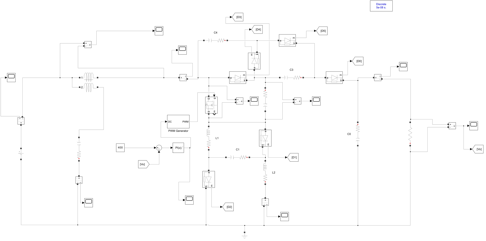
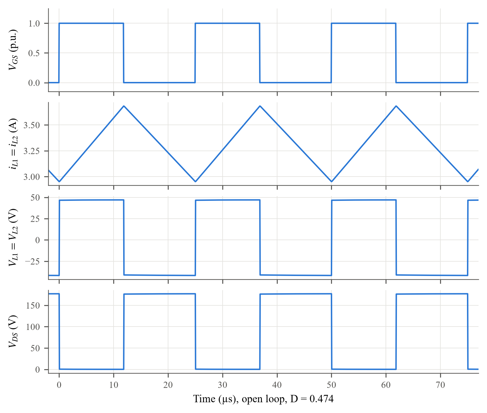
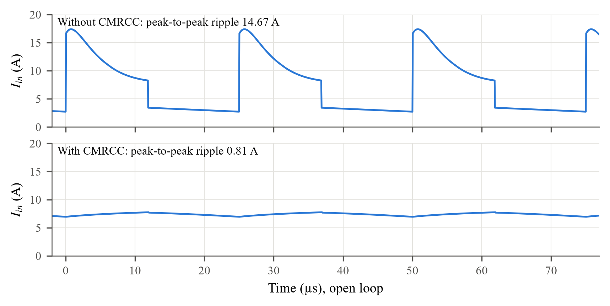
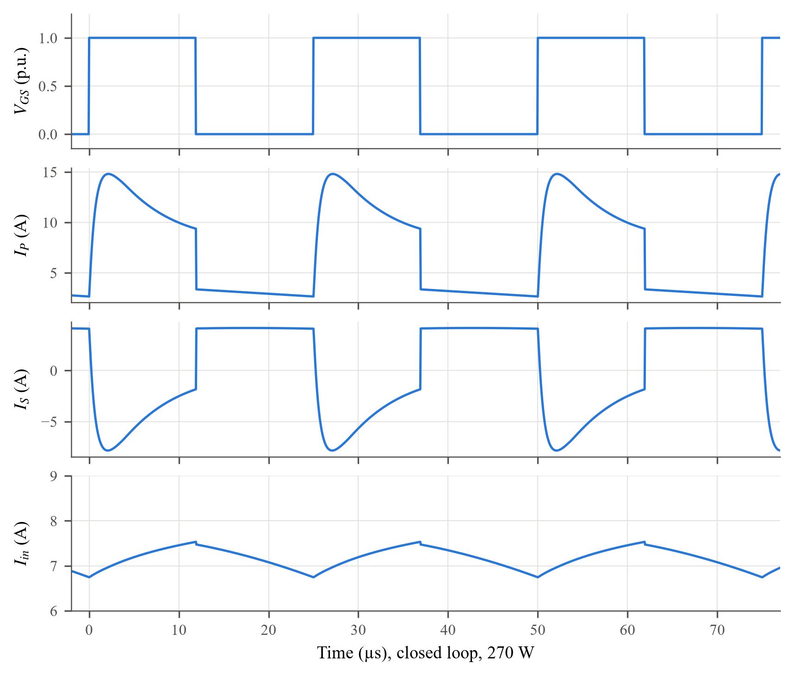
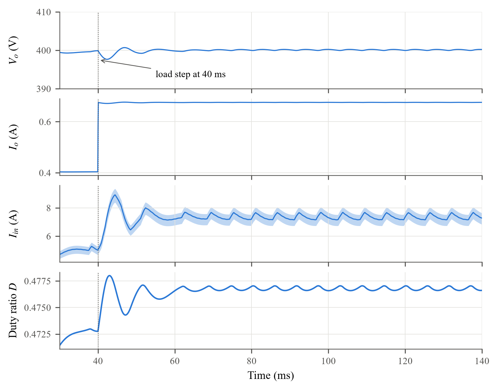

# High-Gain DC–DC Converter with Zero Input Current Ripple — MATLAB/Simulink Implementation

Simulation study of the **single-switch, common-ground high-gain DC–DC converter with a Current Mirror Ripple
Cancellation Circuit (CMRCC)** for fuel cell electric vehicles, based on:

> S. Shetty, S. Mishra, and Vinatha U., "High-gain nonisolated DC–DC converter with zero input current ripple for
> fuel cell electric vehicles," *IEEE Transactions on Transportation Electrification*, vol. 12, no. 2,
> pp. 3731–3742, Apr. 2026. doi: [10.1109/TTE.2025.3646211](https://doi.org/10.1109/TTE.2025.3646211)

The 48 V → 400 V, 270 W, 40 kHz converter was modelled in MATLAB/Simulink (Specialized Power Systems) in open loop,
with the CMRCC, in PI closed loop and under a 160 W → 270 W load step. The design equations were worked out, every
simulated waveform was explained from the circuit equations, and the results were compared with the hardware results
reported in the paper.

*B.Tech Project, Department of Electrical Engineering, Indian Institute of Technology Patna.*

---

## The converter

| | |
|---|---|
| Topology | 1 switch, 2 inductors, 5 capacitors, 6 diodes; switched inductor–capacitor cell + switched capacitor cell + clamping circuit |
| Voltage gain | Gv = (5 − D)/(1 − D) → gain 8.33 at D ≈ 0.455 (a boost converter would need D = 0.88) |
| Switch / diode stress | VDS = VD3,4,5,o = 2Vo/(5 − D) ≈ 176 V,  VD1,2 ≈ 2Vin ≈ 90 V (for Vo = 400 V) |
| Input ripple cancellation | 1:1 coupled windings + blocking capacitor CB inject an anti-phase copy of the ripple at the source |
| Control | Discrete PI, Kp = 0.00159, Ki = 0.35, Ts = 25 µs |

<p align="center"></p>
<p align="center"><em>Closed-loop Simulink model with CMRCC and discrete PI controller</em></p>

## Key results

| Quantity (270 W, closed loop) | Paper (hardware) | This simulation |
|---|---|---|
| Output voltage | 400 V | **400.09 V** |
| Output current | 0.675 A | **0.675 A** |
| Duty ratio | 0.514 | **0.477** (ideal 0.455) |
| Switch voltage stress | 180 V | **177.2 V** |
| Diode stress D1, D2 / D3–D5, Do | 89 V / 180 V | **87.3 V / 176.0–176.6 V** |
| Input current ripple (p-p) | < 1 % | **0.81 A (10.9 %)**, down from 14.7 A without CMRCC (−94.5 %) |
| Load-step 160 → 270 W: undershoot / settling | 12 V / 60 ms | **2.5 V / 4.5 ms** |
| Average input current / efficiency | 5.96 A / 94.4 % | 7.36 A / 76.4 % — **5.91 A / 95.2 %** excluding the default diode snubbers* |

\* The Simulink *Diode* block includes a 500 Ω + 250 nF RC snubber by default. With the diodes blocking ~176 V at
40 kHz these dissipate ≈ 70 W (P ≈ V²·d(1 − d)/R per diode), which is the main reason for the lower simulated
efficiency. Without that loss the simulated input current and efficiency agree closely with the paper.

### Waveforms

| Open-loop key waveforms | Input current without / with CMRCC |
|---|---|
|  |  |
| **CMRCC currents IP, IS, Iin (closed loop)** | **Load step 160 W → 270 W** |
|  |  |

Highlights of the waveform analysis (full derivations in the report):

- **Inductor current** is triangular because each mode applies a constant voltage: +47 V for DTs and −41.7 V for
  (1 − D)Ts. This gives a ripple of 0.74 A (simulated 0.73 A), and the volt–second areas balance.
- **Switch and diode voltages** are rectangular and flat-topped, because a large capacitor clamps each one when it
  is off: (Vo − Vin)/2 = 176 V, and VC1 + |VL,off| ≈ 87.5 V for D1, D2.
- **Input current without CMRCC** is pulsating. It equals one inductor current in Mode-II and two inductor currents
  plus a capacitor-charging pulse (17.4 A peak) in Mode-I.
- **Residual ripple with CMRCC** is the magnetising current of the coupled windings:
  Δi ≈ v_w·DTs/M = 0.10 V × 11.9 µs / 1.485 µH ≈ 0.80 A (simulated 0.81 A).
- **Load-step dip.** To restore 400 V the controller must raise D by 0.004. With Ki·e ≈ 0.7 s⁻¹ that takes about
  6 ms, which sets the depth and timing of the dip.

## Repository structure

```
├── models/                         Simulink models (MATLAB R2024b, Specialized Power Systems)
│   ├── research_paper.slx                        open loop, D = 0.474
│   ├── research_paper_cmrcc.slx                  open loop with CMRCC, D = 0.477
│   ├── research_paper_closed_loop.slx            PI closed loop with CMRCC, 270 W
│   └── research_paper_closed_loop_load_step.slx  load step 160 W → 270 W at t = 40 ms
├── report/
│   ├── Assignment_Report.docx      full report (design equations, waveform analysis, comparison)
│   └── Assignment_Report.pdf
├── figures/
│   ├── results/                    result plots (300 dpi)
│   └── simulink/                   model diagrams
├── results/                        computed metrics (JSON)
│   ├── steady_state_metrics.json   averages / extremes of every signal, load-step transient
│   ├── logged_signal_metrics.json  duty ratio and VDS from the logged runs
│   └── ripple_and_losses.json      per-period input ripple and loss breakdown
├── scripts/
│   ├── matlab/
│   │   ├── export_models.m         export diagrams and block parameters
│   │   ├── extract_fig_data.m      convert scope .fig files to compact .mat data
│   │   └── log_extra_signals.m     re-run model copies logging VGS, VDS, duty ratio
│   └── python/
│       ├── load_data.py
│       ├── compute_metrics.py      metrics, ripple and loss breakdown → results/
│       └── make_plots.py           result figures → figures/results/
└── requirements.txt
```

## Model parameters

| Parameter | Value |
|---|---|
| Vin / Vo / Po | 48 V / 400 V / 270 W (RL = 593 Ω) |
| Switching frequency | 40 kHz |
| L1, L2 | 750 µH, 120 mΩ |
| C1–C4 / Co | 100 µF, 3 mΩ / 100 µF, 50 mΩ |
| MOSFET | Ron = 16 mΩ |
| Diode drop D1, D2 / D3–D5, Do | 0.85 V / 0.12 V (paper: 1.12 V) |
| CMRCC Lp = Ls / M / CB | 1.5 µH, 14 mΩ / 1.485 µH (k = 0.99) / 1000 µF (paper: 15 µF) |
| PI controller | Kp = 0.00159, Ki = 0.35, Ts = 25 µs, D ∈ [0.1, 0.7] |
| Solver | powergui discrete, 50 ns |

## How to run

**Simulations.** Open any model in `models/` with MATLAB R2024b (Simulink + Simscape Electrical) and press *Run*.
The scopes show the output voltage/current, input current, diode voltages/currents, capacitor and inductor
quantities and the CMRCC currents. The models need the Specialized Power Systems library; newer MATLAB releases
without it show the power blocks as unresolved.

**Reproducing the figures and metrics.**

1. In each model, use *Print to Figure* on the scopes and save the `.fig` files into `data/scope_figs/`. These files
   are 20–480 MB each, so they are not stored in this repository.
2. In MATLAB, from the repository root:
   ```matlab
   run scripts/matlab/extract_fig_data.m    % data/scope_figs/*.fig -> data/fig_data/*.mat
   run scripts/matlab/log_extra_signals.m   % logs VGS, VDS, duty ratio -> data/sim/*.mat
   ```
3. In Python 3.10+:
   ```bash
   pip install -r requirements.txt
   cd scripts/python
   python compute_metrics.py    # -> results/*.json
   python make_plots.py         # -> figures/results/*.png
   ```

## Differences from the paper (summary)

| Difference | Reason |
|---|---|
| Lower duty ratio (0.477 vs 0.514) | Smaller diode drops (0.12 V vs 1.12 V) and ideal switching in the model |
| Stresses ~2 % lower | They follow D and the capacitor voltages; hardware peaks include ringing from stray inductance |
| Higher input current, lower efficiency | Default Simulink diode snubbers dissipate ≈ 70 W |
| Residual input ripple 10.9 % vs < 1 % | Magnetising current of the CMRCC windings (k = 0.99, winding resistance); CB = 1000 µF vs 15 µF |
| Smaller, faster load-step transient | Ideal sensing and no DSP/ADC delay; ideal source and load switching |

## Future work

- Disable the diode snubbers (Rs = inf) and use 1.12 V fast-diode drops to match the prototype.
- Re-run the CMRCC with CB = 15 µF and a higher magnetising inductance to reach a ripple below 1 %.
- Simulate the load step-down and the 48 V ↔ 40 V source steps; plot the loop-gain Bode diagram.

## Notes

- The paper itself is not included here because of IEEE copyright; it is available through the DOI above.
- Figures of hardware results inside the report are reproduced from the paper for comparison and remain © IEEE.

## Author

**Sripada Manaswini** — B.Tech, IIT Patna · [github.com/manaswini35](https://github.com/manaswini35)
